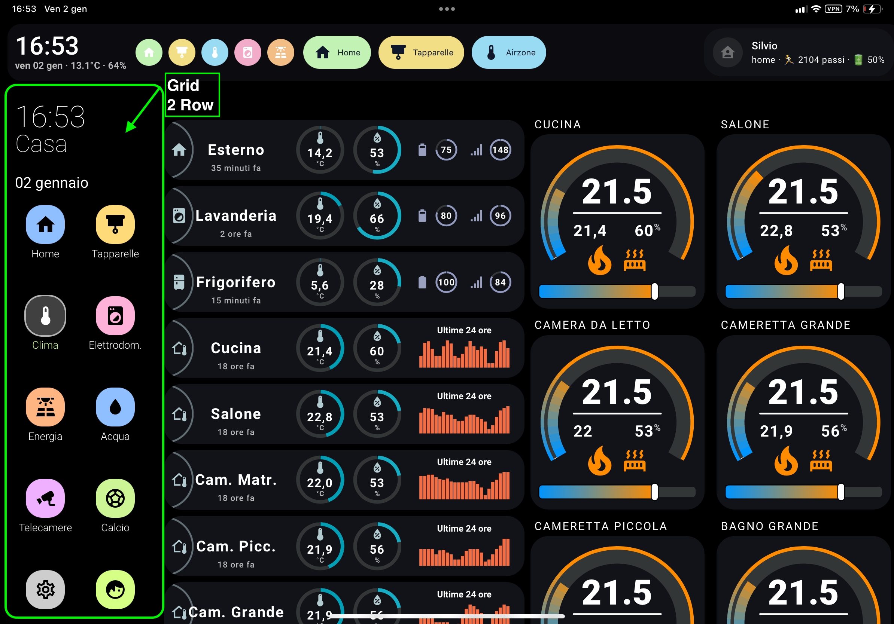
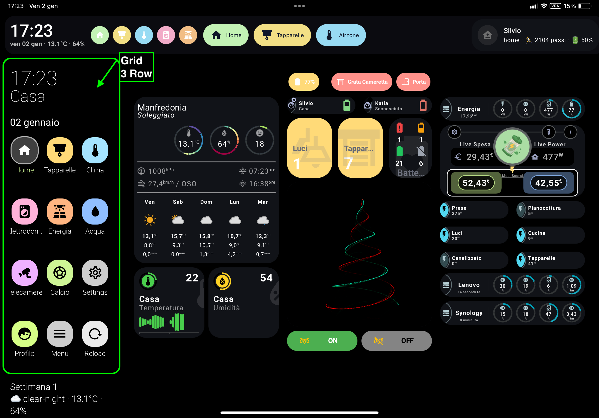
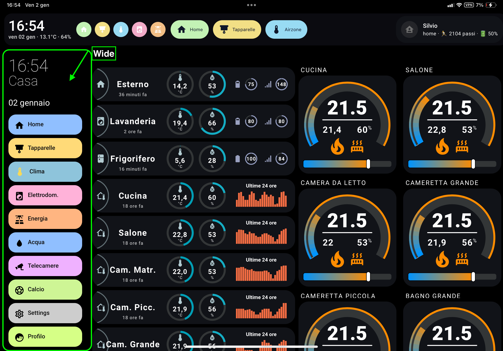
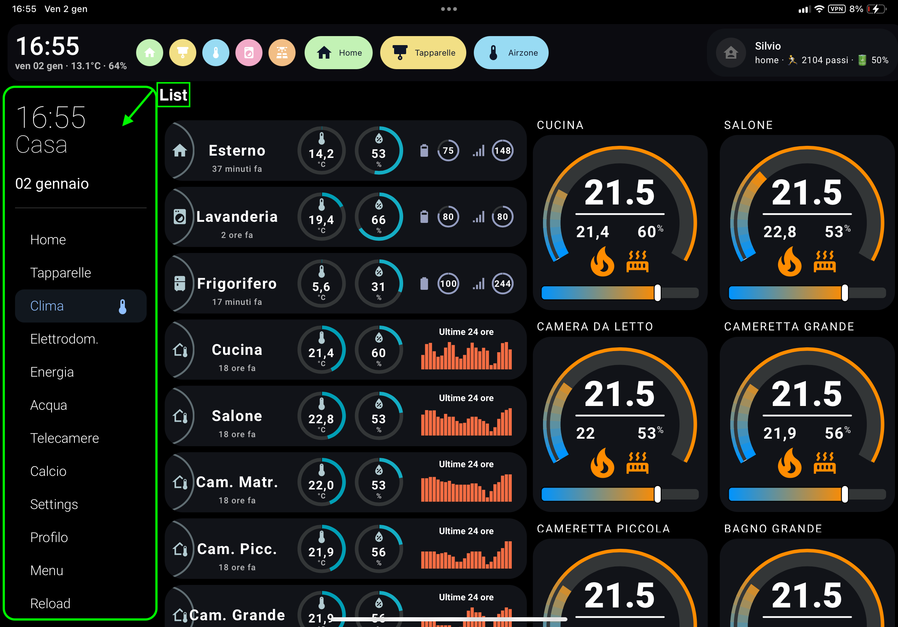
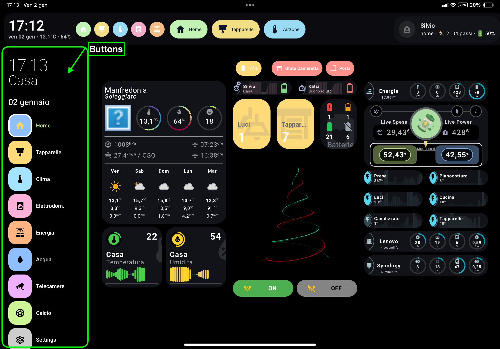
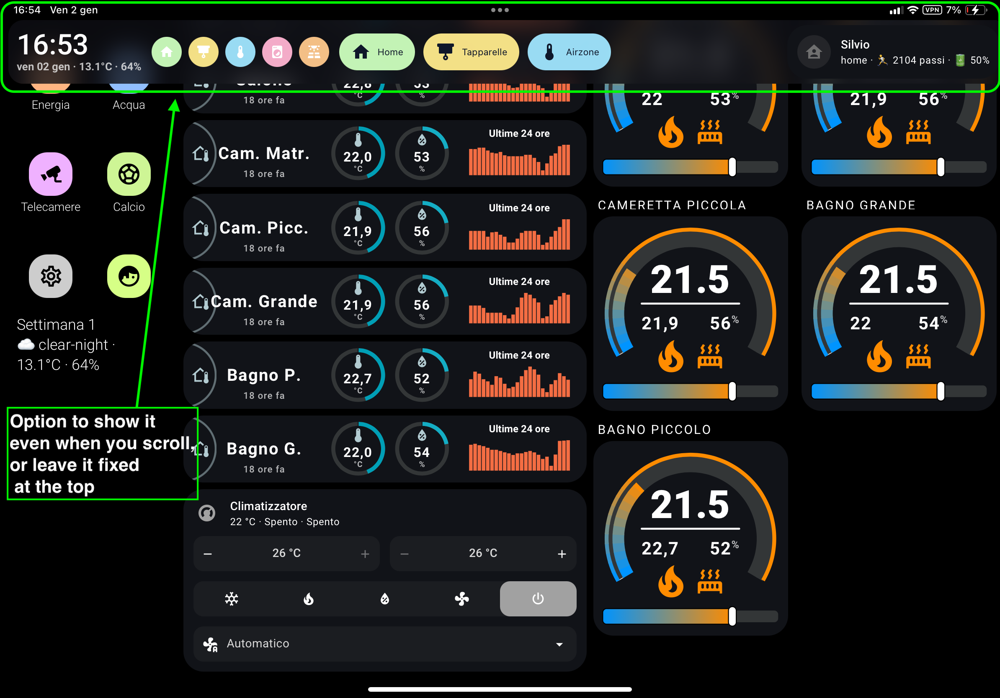

[](https://ko-fi.com/silviosmart)

# 🧭 Sidebar & Header personalizzati per Home Assistant
[🇬🇧 English](README.md)

## 📸 Screenshot


<p align="center">
  
  
</p>

<p align="center">
  
  
</p>

<p align="center">
  
  
</p>

Sistema **completamente personalizzabile** di **Header + Sidebar** per Home Assistant, moderno, fluido e responsive — compatibile con qualsiasi dashboard Lovelace.

---

## ⭐ Funzionalità

- Sidebar responsive (mobile / tablet / desktop)
- Header fisso con effetto vetro
- **4 stili menu (list / wide / buttons / grid)**
- Voci condizionali
- Colori e icone per singola voce
- Possibilità di nascondere sidebar & top‑bar originali
- Template HTML per messaggi dinamici
- Supporto card personalizzate
- Compatibile con kiosk‑mode
- Sicuro: non modifica il core di Lovelace

---

# 📦 Installazione

## HACS (Consigliata)

```yaml
url: /hacsfiles/sidebar-card/sidebar-card.js
type: module
```

## Manuale

```yaml
url: /local/sidebar-card.js
type: module
```

---

# 🚀 Configurazione Base

```yaml
sidebar:
  enabled: true
  width: { mobile: 0, tablet: 16, desktop: 18 }

header:
  enabled: true
  sticky: true
  height: 72
```

---

# 🧭 Opzioni Sidebar

| Opzione | Tipo | Default | Descrizione |
|--------|------|---------|-------------|
| enabled | bool | true | abilita sidebar |
| debug | bool | false | log console |
| title | string | "" | titolo opzionale |
| clock | bool | false | orologio analogico |
| digitalClock | bool | false | orologio digitale |
| digitalClockWithSeconds | bool | false | mostra i secondi |
| twelveHourVersion | bool | false | formato 12 ore |
| period | bool | false | mostra AM/PM |
| date | bool | true | mostra data |
| dateFormat | string | DD MMMM | formato data |
| updateMenu | bool | true | evidenzia la voce attiva |
| hideHassSidebar | bool | false | nasconde la sidebar HA |
| hideTopMenu | bool | false | nasconde la barra alta |
| showTopMenuOnMobile | bool | true | mostra top‑bar solo su mobile |
| width | numero/oggetto | 18 | larghezza percentuale |
| breakpoints.mobile | int | 767 | max mobile |
| breakpoints.tablet | int | 1024 | max tablet |
| hideOnPath | lista | — | pagine dove nasconderla |
| menuStyle | string | list | `list / wide / buttons / grid` |
| showLabel | bool | true | mostra il testo |
| template | jinja | — | HTML dinamico |
| bottomCard | card | — | card in fondo |

---

# 📐 Larghezza Responsive

```yaml
width:
  mobile: 0
  tablet: 16
  desktop: 18
```

---

# 📋 Voci Menu Sidebar

```yaml
sidebarMenu:
  - action: navigate
    navigation_path: "/home"
    name: "Home"
    icon: mdi:home
    background_color: "var(--blue)"
    icon_color: "#000"
    text_color: "#000"
```

Azioni supportate: `navigate`, `toggle`, `url`, `more-info`, `call-service`, `service-js`

Campi aggiuntivi:

- `state:` entità per marcare la voce come attiva
- `conditional:` se falso → nasconde la voce

---

# 🎨 Stili Menu

| menuStyle | Descrizione |
|-----------|-------------|
| list | lista semplice |
| wide | **pill lunghe colorate con icona + testo** |
| buttons | bottoni quadrati |
| grid | griglia stile iPhone |

## Esempio stile wide

```yaml
sidebar:
  menuStyle: wide
  showLabel: true
```

```yaml
- action: navigate
  name: "Energia"
  icon: mdi:solar-power-variant
  navigation_path: "/energia"
  background_color: "rgba(255, 200, 140, 0.95)"
  icon_color: "#0f172a"
  text_color: "#0f172a"
```

---

# 🧱 Header

```yaml
header:
  enabled: true
  sticky: true
  height: 72
  headerMenuStyle: wide
  headerMenuShowLabel: true
  headerMenuPosition: center
```

---

# 🎨 Variabili CSS

(identiche a quelle elencate nella versione inglese)

---

# 🛠 Problemi comuni

- svuota la cache browser
- disattiva plugin di layout in conflitto
- prova senza tema grafico

---

# ❤️ Crediti

Creato per la community Home Assistant 🙂
