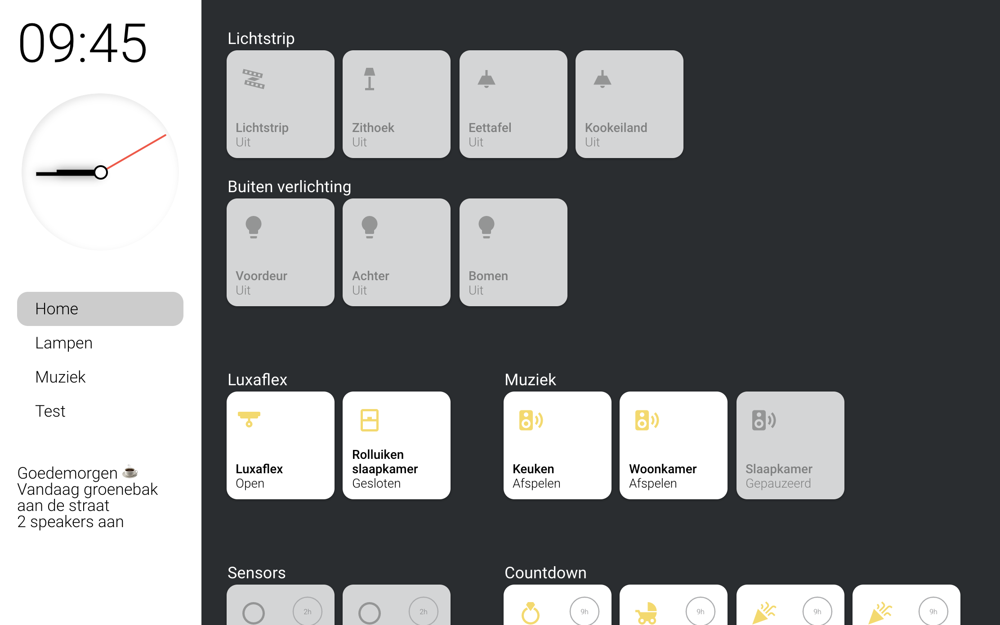
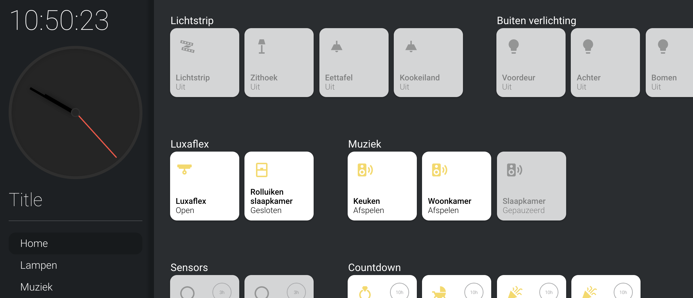

# THANKS DBuit for original work 
https://github.com/DBuit/sidebar-card

# Sidebar card

This card adds a sidebar to your interface which you can configure globally so every page has the same navigation and extra information.  
It can **replace the top navigation** or **complement it** with extra controls, icons and custom content.

---

## ✨ Highlights / New features

- Multiple **menu layouts** via `menuStyle`:
  - `list` – original simple list
  - `wide` – full-width pill buttons (icon + text)
  - `buttons` – square colored icons, with optional label on the right
  - `grid` – iOS-like grid: icon in a rounded square with label underneath
- **Per-entry colors** for icons and backgrounds:
  - `background_color`
  - `icon_color`
- **Config-driven theming**:
  - Different CSS variables for `wide`, `buttons` and `grid`
  - All overridable in `sidebar: style: |` via `:host { ... }`
- Optional **visibility conditions** for menu items (simple Jinja-like expressions)
- Keeps support for:
  - Clocks, date, templates, bottom card, breakpoints, width, etc.

---

## Installation Instructions

## HACS

This integration can be installed manually or via HACS when available.

[](https://my.home-assistant.io/redirect/hacs_repository/?owner=bobsilvio&repository=sidebar-card&category=integration)

### Manual Installation

1. Build / download `sidebar-card.js` from the `dist` directory
2. Copy it into `<config>/www/sidebar-card.js`
3. Add the resource to your Lovelace config:

```yaml
resources:
  - url: /local/sidebar-card.js
    type: module
```

---

## Configuration

The configuration is defined at the root of your Lovelace YAML under `sidebar:`  
(on the same level as `resources:` and `views:`).

```yaml
resources:
  - url: /local/sidebar-card.js?v=0.0.1
    type: module   

sidebar:
  title: "Sidebar title"
  menuStyle: wide     # list | wide | buttons | grid
  sidebarMenu: ...
views:
  ...
```

---

## Main Options

Under `sidebar:` you can configure the following options:

| Name                         | Type     | Default | Supported Options                                | Description                                                                                                                                                                 |
|------------------------------|----------|---------|--------------------------------------------------|-----------------------------------------------------------------------------------------------------------------------------------------------------------------------------|
| `title`                      | string   | –       | any string                                       | Title shown in the sidebar (above the menu).                                                                                                                                |
| `clock`                      | boolean  | false   | `true` / `false`                                 | Show an analog clock.                                                                                                                                                       |
| `date`                       | boolean  | false   | `true` / `false`                                 | Show the current date.                                                                                                                                                      |
| `dateFormat`                 | string   | `DD MMMM` | Moment.js format                                  | Format for the date (see [Moment.js docs](https://momentjs.com/docs/#/parsing/string-format/)).                                                                            |
| `digitalClock`               | boolean  | true    | `true` / `false`                                 | Show a digital clock.                                                                                                                                                       |
| `digitalClockWithSeconds`    | boolean  | true    | `true` / `false`                                 | Show seconds in the digital clock.                                                                                                                                          |
| `twelveHourVersion`          | boolean  | false   | `true` / `false`                                 | Use 12-hour clock instead of 24-hour when `digitalClock` is enabled.                                                                                                       |
| `period`                     | boolean  | false   | `true` / `false`                                 | When using 12-hour clock, show `AM` / `PM`.                                                                                                                                |
| `sidebarMenu`                | list     | –       | see section below                                | Array of menu items (navigation, toggle, call-service, url, etc.).                                                                                                         |
| `menuStyle`                  | string   | `list`  | `list`, `wide`, `buttons`, `grid`               | Layout style for the menu (see **Menu Layouts** section).                                                                                                                   |
| `showLabel`                  | boolean  | false   | `true` / `false`                                 | When `menuStyle: buttons`, show the text label to the right of the square icon. Ignored for `list`, `wide` and `grid` (grid always shows label under the icon).            |
| `updateMenu`                 | boolean  | true    | `true` / `false`                                 | When `false`, the active state of the sidebar is not updated on navigation.                                                                                                |
| `template`                   | template | –       | see section below                                | Jinja-like template that renders a custom `<li>` / `<div>` list to be shown under the clock/date/title.                                                                   |
| `style`                      | css      | –       | custom CSS                                       | Extra CSS injected into the card. Use `:host { ... }` to override variables and styles.                                                                                     |
| `width`                      | object   | 25%     | `{ mobile, tablet, desktop }` in %               | Sidebar width in percentages per breakpoint. See **Width** section.                                                                                                         |
| `breakpoints`                | object   | see doc | `{ mobile, tablet }` in px                       | Custom breakpoints for mobile / tablet / desktop.                                                                                                                           |
| `bottomCard`                 | object   | –       | see section below                                | Any HA card (or custom card) rendered at the bottom of the sidebar.                                                                                                        |
| `showTopMenuOnMobile`        | boolean  | true    | `true` / `false`                                 | If `hideTopMenu` is enabled, this still shows the top menu on mobile.                                                                                                      |
| `hideHassSidebar`            | boolean  | true    | `true` / `false`                                 | Hide Home Assistant’s built-in left sidebar.                                                                                                                                |
| `hideOnPath`                 | list     | –       | e.g. `/lovelace/camera`                          | Paths where this custom sidebar should be hidden.                                                                                                                           |
| `hideTopMenu`                | boolean  | true    | `true` / `false`                                 | Hide the default Home Assistant top bar.                                                                                                                                    |
| `debug`                      | boolean  | false   | `true` / `false`                                 | Log debug messages in the browser’s developer console.                                                                                                                     |

> 💡 When using **hideTopMenu** and/or **hideHassSidebar**, you can temporarily disable the custom sidebar by appending `?sidebarOff` to the URL, e.g.:  
> `https://myhomeassistant.duckdns.org/lovelace/home?sidebarOff`

---

## Width

By default, the sidebar is `25%` wide on all screen sizes.  
You can override this with the `width` object, specifying percentages for `mobile`, `tablet` and `desktop`.

Example (hide sidebar on mobile):

```yaml
sidebar:
  width:
    mobile: 0
    tablet: 25
    desktop: 20
```

---

## Breakpoints

Breakpoints decide when `mobile`, `tablet` or `desktop` widths apply.  
By default:

- `mobile`: `<= 768px`
- `tablet`: `<= 1024px`
- `desktop`: `> 1024px`

You can override them:

```yaml
sidebar:
  breakpoints:
    mobile: 768
    tablet: 1024
```

---

## Menu Layouts (`menuStyle`)

### 1. `list` (default)

Classic sidebar: simple list of entries with optional icons.

```yaml
sidebar:
  menuStyle: list
  sidebarMenu:
    - action: navigate
      navigation_path: /lovelace/home
      name: Home
      icon: mdi:home
```

---

### 2. `wide` – full-width pill buttons

Each entry is a rounded “pill” spanning the full width: icon + label.

```yaml
sidebar:
  menuStyle: wide
  sidebarMenu:
    - action: navigate
      navigation_path: /lovelace/home
      name: Home
      icon: mdi:home
    - action: navigate
      navigation_path: /lovelace/lights
      name: Lights
      icon: mdi:lightbulb
```

You can style `wide` buttons via variables (see **Styling**):

```yaml
sidebar:
  style: |
    :host {
      --sidebar-wide-bg: rgba(255,255,255,0.15);
      --sidebar-wide-text-color: #111111;
      --sidebar-wide-icon-color: #111111;

      --sidebar-wide-active-bg: #ffffff;
      --sidebar-wide-active-border-width: 2px;
      --sidebar-wide-active-border-color: rgba(255,255,255,0.7);
      --sidebar-wide-active-icon-color: #f7d959;
      --sidebar-wide-active-text-color: #ffffff;
    }
```

---

### 3. `buttons` – square colored icons (optionally with text)

Ideal for a **minimal vertical icon bar** (only icons) or **icons + label**.

```yaml
sidebar:
  menuStyle: buttons
  showLabel: true      # false = only square icons
  sidebarMenu:
    - action: navigate
      navigation_path: /lovelace/home
      name: Home
      icon: mdi:home
    - action: navigate
      navigation_path: /lovelace/lights
      name: Lights
      icon: mdi:lightbulb
```

Styling example:

```yaml
sidebar:
  style: |
    :host {
      /* background for the square icon */
      --sidebar-button-bg: rgba(255,255,255,0.18);
      --sidebar-button-icon-color: #000000;
      --sidebar-button-text-color: var(--primary-text-color);

      /* when active */
      --sidebar-button-active-border-color: #ffffff;
      --sidebar-button-active-shadow-color: rgba(0,0,0,0.18);
      --sidebar-button-active-icon-color: #f7d959;
      --sidebar-button-active-text-color: #ffffff;
    }
```

---

### 4. `grid` – iOS-like icon grid

Icons in rounded squares with label underneath, arranged in a **grid**.

```yaml
sidebar:
  menuStyle: grid
  style: |
    :host {
      --sidebar-grid-columns: 4;          # icons per row
      --sidebar-grid-rows: 2;             # visible rows before scrolling
      --sidebar-grid-row-height: 100px;   # height of each “row”
      --sidebar-grid-box-size: 72px;      # square size
      --sidebar-grid-icon-size: 40px;     # icon size inside the square
    }
  sidebarMenu:
    - action: navigate
      navigation_path: /lovelace/home
      name: Home
      icon: mdi:home
    - action: navigate
      navigation_path: /lovelace/lights
      name: Lights
      icon: mdi:lightbulb
    - action: navigate
      navigation_path: /lovelace/climate
      name: Climate
      icon: mdi:thermostat
    # ...
```

Additional grid variables (all optional):

- `--sidebar-grid-margin-y`
- `--sidebar-grid-gap`
- `--sidebar-grid-item-padding`
- `--sidebar-grid-radius`
- `--sidebar-grid-font-size`
- `--sidebar-grid-font-weight`
- `--sidebar-grid-text-color`
- `--sidebar-grid-active-border`
- `--sidebar-grid-active-bg`
- `--sidebar-grid-active-icon-color`
- `--sidebar-grid-active-text-color`

---

## `sidebarMenu` entries

Each item in `sidebarMenu` supports the following options:

| Name               | Type   | Default | Description                                                                                                             |
|--------------------|--------|---------|-------------------------------------------------------------------------------------------------------------------------|
| `action`           | string | `toggle` | `more-info`, `toggle`, `call-service`, `none`, `navigate`, `url`                                                       |
| `entity`           | string | –       | Entity id. Used with `more-info` and `toggle`.                                                                          |
| `navigation_path`  | string | –       | Path to navigate to when `action: navigate` (e.g. `/lovelace/home`).                                                   |
| `url_path`         | string | –       | URL opened in a new tab when `action: url`.                                                                             |
| `service`          | string | –       | Service to call when `action: call-service` (e.g. `media_player.media_play_pause`).                                    |
| `service_data`     | object | –       | Service data (e.g. `{ entity_id: media_player.living_room }`).                                                         |
| `icon`             | string | –       | Icon (e.g. `mdi:home`).                                                                                                 |
| `name`             | string | –       | Label to show (depending on `menuStyle` / `showLabel`).                                                                 |
| `state`            | string | –       | Entity id whose state defines whether the menu item is considered “on”/“active”.                                       |
| `background_color` | string | –       | Per-item background color for wide / buttons / grid (overrides global bg).                                             |
| `icon_color`       | string | –       | Per-item icon color (overrides global icon color).                                                                      |
| `conditional`      | string | –       | Simple visibility condition e.g. `{{ is_state('person.silvio', 'home') }}` or `{{ states['sensor.temp'] | int > 25 }}` |

Example:

```yaml
sidebar:
  menuStyle: buttons
  showLabel: true
  sidebarMenu:
    - action: navigate
      navigation_path: "/lovelace/home"
      name: "Home"
      icon: mdi:home
      background_color: "rgba(255,255,255,0.20)"
      icon_color: "#000000"
    - action: navigate
      navigation_path: "/lovelace/lights"
      name: "Lights"
      icon: mdi:lightbulb
      state: light.house_all
      conditional: "{{ is_state('light.house_all', 'on') }}"
    - action: toggle
      entity: light.house_all
      name: "All Lights"
      icon: mdi:light-switch
```

> When using `action: navigate` and a `navigation_path` that matches your views, the card will automatically mark the corresponding entry as “active” based on the current path.

---

## Template

The `template` option lets you insert arbitrary HTML list items (and simple `<div>`s) below the header.

- Each line must start with `<li>` or `<div>` and end with `</li>` or `</div>`.
- Inside you can use standard Home Assistant template syntax.

Example:

```yaml
sidebar:
  template: |
    <li style="margin-top:6px;">
       Good morning ☕
       Good afternoon 👋
       Good evening 🌙
    </li>
    <li>Week {{ now().isocalendar()[1] }}</li>
```

You can mix this with any other content like `sensors`, `weather.entities`, etc.

---

## Styling

You can override or extend styles by using the `style:` option with a CSS block.  
Use `:host { ... }` to override theme variables.

### Core variables

```yaml
sidebar:
  style: |
    :host {
      --sidebar-background: #ffffff;
      --sidebar-text-color: #000000;
      --sidebar-icon-color: #000000;

      --face-color: #ffffff;
      --face-border-color: #ffffff;
      --clock-hands-color: #000000;
      --clock-seconds-hand-color: #ff4b3e;
      --clock-middle-background: #ffffff;
      --clock-middle-border: #000000;
    }
```

### Wide-specific variables

```yaml
sidebar:
  style: |
    :host {
      --sidebar-wide-bg: rgba(255,255,255,0.15);
      --sidebar-wide-icon-color: #111111;
      --sidebar-wide-text-color: #111111;

      --sidebar-wide-active-bg: #ffffff;
      --sidebar-wide-active-border-width: 2px;
      --sidebar-wide-active-border-color: rgba(255,255,255,0.7);
      --sidebar-wide-active-icon-color: #f7d959;
      --sidebar-wide-active-text-color: #ffffff;
    }
```

### Buttons-specific variables

```yaml
sidebar:
  style: |
    :host {
      --sidebar-button-bg: rgba(255,255,255,0.18);
      --sidebar-button-icon-color: #000000;
      --sidebar-button-text-color: var(--primary-text-color);

      --sidebar-button-active-border-color: #ffffff;
      --sidebar-button-active-shadow-color: rgba(0,0,0,0.18);
      --sidebar-button-active-icon-color: #f7d959;
      --sidebar-button-active-text-color: #ffffff;
    }
```

### Grid-specific variables

```yaml
sidebar:
  style: |
    :host {
      --sidebar-grid-columns: 4;
      --sidebar-grid-rows: 2;
      --sidebar-grid-row-height: 100px;
      --sidebar-grid-gap: 12px;

      --sidebar-grid-box-size: 72px;
      --sidebar-grid-radius: 22px;
      --sidebar-grid-icon-size: 40px;

      --sidebar-grid-text-color: var(--primary-text-color);
      --sidebar-grid-active-border: rgba(255,255,255,0.7);
      --sidebar-grid-active-bg: rgba(255,255,255,0.25);
      --sidebar-grid-active-icon-color: #f7d959;
      --sidebar-grid-active-text-color: var(--primary-text-color);
    }
```

---

## Bottom Custom Card

You can render any card at the bottom of the sidebar via `bottomCard`.

Structure:

1. `type` – any built-in or custom card
2. `cardOptions` – standard card configuration options
3. `cardStyle` (optional) – extra CSS injected into the card

Example:

```yaml
sidebar:
  bottomCard:
    type: horizontal-stack
    cardOptions:
      cards:
        - type: "custom:button-card"
          color_type: card
          color: rgb(255, 255, 255)
          icon: mdi:home
        - type: "custom:button-card"
          color_type: card
          color: rgb(255, 255, 255)
          icon: mdi:lightbulb
    cardStyle: |
      :host {
        width: 100%;
        background-color: #ffffff;
      }
```

---
# Sidebar Card – CSS Variables Reference (English)

## 🎨 CSS Variables Overview
The sidebar card supports a wide set of CSS variables that allow full control of colors, icons, backgrounds, borders, and active‑state styling.

All variables can be defined inside:

```yaml
sidebar:
  style: |
    :host {
      --variable-name: value;
    }
```

---

# 🟥 GLOBAL VARIABLES  
(Affect all menu styles unless overridden)

| Variable | Description |
|---------|-------------|
| `--sidebar-background` | Background color of the sidebar |
| `--sidebar-text-color` | Default text color |
| `--sidebar-icon-color` | Default icon color |
| `--sidebar-selected-bg` | Background overlay when active |
| `--sidebar-selected-icon-color` | Icon color when active |

---

# 🟦 WIDE STYLE  
(Rectangular full‑width buttons)

## Normal state

| Variable | Description |
|---------|-------------|
| `--sidebar-wide-bg` | Background of the wide button |
| `--sidebar-wide-text-color` | Text color |
| `--sidebar-wide-icon-color` | Icon color |

## Active state

| Variable | Description |
|---------|-------------|
| `--sidebar-wide-active-bg` | Background overlay when active |
| `--sidebar-wide-active-border-width` | Border width when selected |
| `--sidebar-wide-active-border-color` | Border color when selected |
| `--sidebar-wide-active-text-color` | Text color when active |
| `--sidebar-wide-active-icon-color` | Icon color when active |

---

# 🟩 BUTTONS STYLE  
(Square icon button with optional label)

## Normal state

| Variable | Description |
|---------|-------------|
| `--sidebar-button-bg` | Background of the icon square |
| `--sidebar-button-icon-color` | Icon color |
| `--sidebar-button-text-color` | Label text color |

## Active state

| Variable | Description |
|---------|-------------|
| `--sidebar-button-active-border-color` | Border color when active |
| `--sidebar-button-active-shadow-color` | Glow around selected button |
| `--sidebar-button-active-icon-color` | Icon color when active |
| `--sidebar-button-active-text-color` | Label color when active |

---

# 🟧 GRID STYLE  
(iPhone-style icons: large square + label underneath)

## Normal state

| Variable | Description |
|---------|-------------|
| `--sidebar-grid-bg` | Background of the icon square |
| `--sidebar-grid-icon-color` | Icon color |
| `--sidebar-grid-text-color` | Label text color |
| `--sidebar-grid-size` | Square size (default 72px) |
| `--sidebar-grid-icon-size` | Icon size inside square (default 40px) |

## Active state

| Variable | Description |
|---------|-------------|
| `--sidebar-grid-active-bg` | Background overlay when active |
| `--sidebar-grid-active-border` | Glow/border around selected icon |
| `--sidebar-grid-active-icon-color` | Icon color when active |
| `--sidebar-grid-active-text-color` | Label color when active |

---

# 🟪 Example usage

```yaml
sidebar:
  style: |
    :host {
      --sidebar-background: #111;
      --sidebar-text-color: #fff;

      --sidebar-wide-bg: rgba(255,255,255,0.12);
      --sidebar-wide-icon-color: #fff;
      --sidebar-wide-text-color: #fff;

      --sidebar-wide-active-bg: #fff;
      --sidebar-wide-active-border-color: #ffcc00;
      --sidebar-wide-active-border-width: 2px;

      --sidebar-button-bg: rgba(255,255,255,0.15);
      --sidebar-button-icon-color: #000;

      --sidebar-grid-bg: rgba(255,255,255,0.15);
      --sidebar-grid-icon-color: #000;
      --sidebar-grid-text-color: #fff;
      --sidebar-grid-size: 72px;
      --sidebar-grid-icon-size: 40px;

      --sidebar-grid-active-bg: rgba(255,255,255,0.25);
      --sidebar-grid-active-border: rgba(255,255,255,0.7);
      --sidebar-grid-active-icon-color: #ffcc00;
    }
```

---

If you want, I can also generate a visual documentation table, examples for each layout style, or a dedicated README block.

---
## Screenshots

*(Update with your own screenshots for list / wide / buttons / grid as needed.)*




